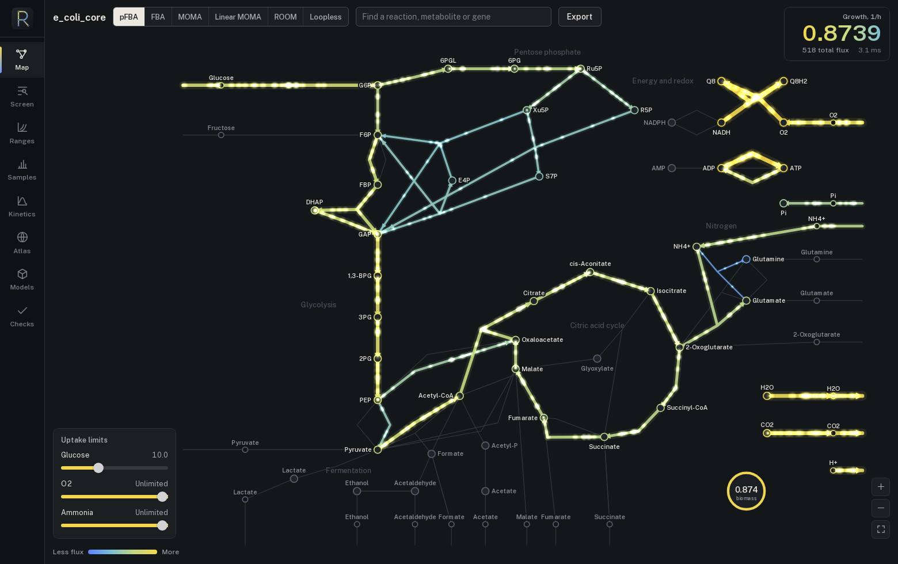
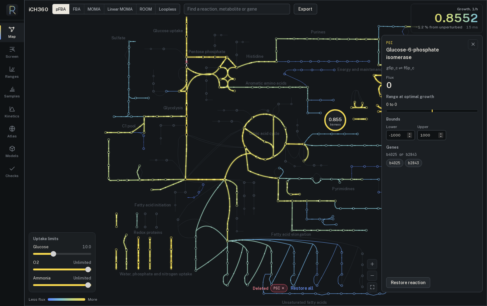
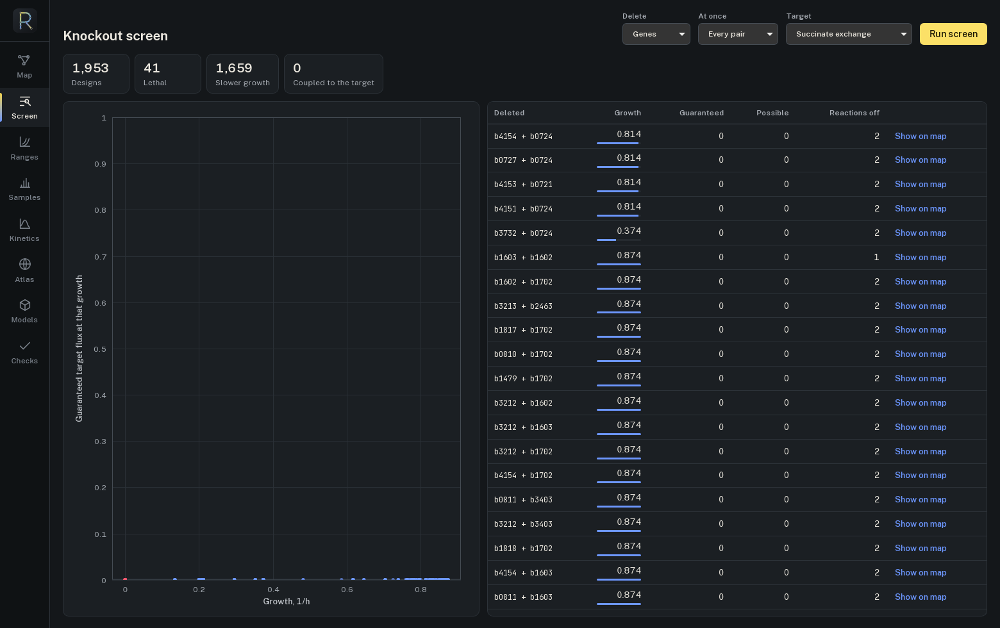
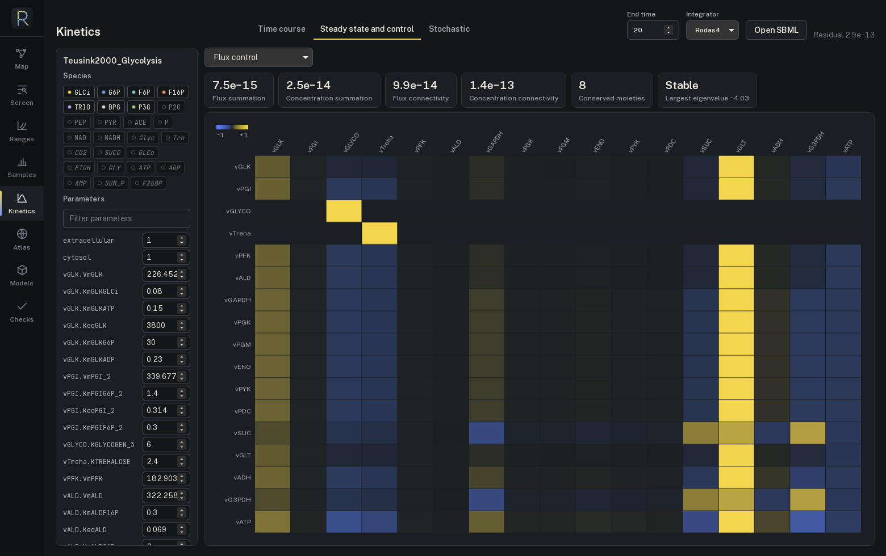
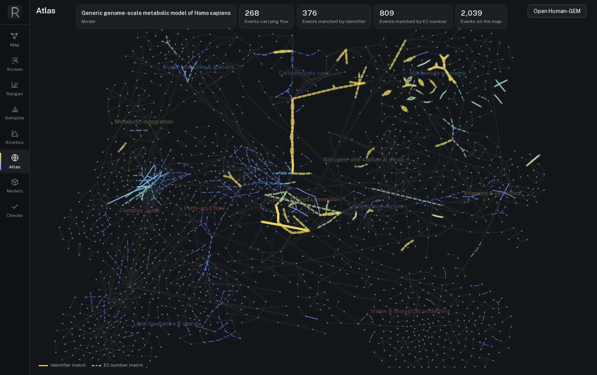

# Rashevsky

Genome-scale constraint-based modelling and detailed kinetic modelling of metabolism, in one engine.

Which gene knockouts raise product yield? Which enzymes control a pathway's flux? What can a cell do on given nutrients, within thermodynamics? Rashevsky answers these from SBML models through a Rust library, a command line, Python bindings and a desktop workbench.



Named after Nicolas Rashevsky (1899-1972), founder of mathematical biophysics.

## What it does

**Constraint-based:** flux balance analysis, parsimonious FBA, flux variability, loopless FBA and CycleFreeFlux, MOMA and ROOM, single and double gene or reaction deletions, synthetic lethal pairs, production envelopes, minimal media, dynamic FBA, flux sampling (CHRR, OptGP) with convergence diagnostics, thermodynamics-based flux analysis, enzyme constraints in the style of GECKO, and metabolic task checks in the format of RAVEN and Human-GEM.

**Kinetic:** SBML core Levels 2 and 3 with rules, events, delays, conversion factors and `rateOf`; stiff integration with Rodas4 and variable-order BDF on analytic Jacobians; steady states with moiety conservation; metabolic control analysis; local and global sensitivity; parameter estimation with profile likelihood; stochastic simulation (Gillespie, tau-leaping).

**Formats:** SBML Level 3 with FBC and groups, read and written. Escher maps and flux data. Flux overlays for the metabolism map at [biochemistry.draconitic.com](https://biochemistry.draconitic.com).

## How far to trust it

Each row is a named published result or another tool on the same input, with the commands to reproduce it in [docs/VALIDATION.md](docs/VALIDATION.md).

| Check | Reference | Result |
| --- | --- | --- |
| `e_coli_core` growth | 0.8739 1/h, BiGG and COBRApy | 0.873922, equal to COBRApy within 1e-11 |
| Flux variability | COBRApy, tolerance 1e-6 | largest difference 3e-11 on `e_coli_core`, 2e-6 on iML1515 |
| iML1515 gene essentiality | Keio screens, Monk et al. 2017: 93.4 % | 93.48 % of 23,617 phenotypes; 1 row differs from the paper, traced to the model file |
| Human-GEM | 57 essential tasks, Robinson et al. 2020 | 57 of 57, same verdicts as RAVEN |
| Yeast glycolysis | Teusink et al. 2000, libRoadRunner | same steady state within 1e-14 |
| Control coefficients | COPASI | largest difference 3e-7 |
| Control theorems | exact | hold to 6e-12 on five published models |
| SBML semantic suite | SBML Test Suite 3.5.0 | 1,700 of 1,700 applicable cases, with either integrator |
| Stochastic suite | DSMTS | 38 of 39 by the suite's criterion; case 00003 exceeds it because of its kurtosis, and matches its exact law |

## Install

The desktop application, on Linux with WebKitGTK 4.1:

```
sudo dnf install webkit2gtk4.1-devel gtk3-devel cmake clang-libs   # or the equivalents for your system
desktop/scripts/install.sh
```

This adds **Rashevsky** to the applications menu and the desktop. Drop an SBML file on the icon to open it; its right-click menu goes straight to a knockout screen, yeast glycolysis, the human atlas or the validation results.

The command line:

```
cargo install --path crates/rashevsky-cli
```

Python 3.9 or later:

```
pip install maturin && maturin develop --release
```

The build compiles HiGHS from source, and it needs CMake, a C++ compiler and libclang.

## Use

```
rashevsky fba models/e_coli_core/e_coli_core.xml.gz
rashevsky fba model.xml --ko-gene b4025 --bound EX_o2_e=0:1000
rashevsky fva iML1515.xml.gz --fraction 0.9
rashevsky deletion iML1515.xml.gz --kind gene --order 1
rashevsky envelope model.xml --control EX_o2_e --target EX_ac_e
rashevsky sample model.xml --method chrr --fraction 0.9
rashevsky tasks Human-GEM.xml metabolicTasks_Essential.txt
rashevsky simulate models/teusink/BIOMD0000000064.xml --end 20 --method bdf
rashevsky mca models/teusink/BIOMD0000000064.xml
rashevsky --help
```

Every command prints JSON, or writes it to the file given by `--out`.

```python
import rashevsky as rv

model = rv.read_sbml("models/e_coli_core/e_coli_core.xml.gz")
model.fba()["objective"]                                  # 0.8739
model.fba(knockout_genes=["b4025"])["objective"]          # 0.8632
model.fva(fraction=0.9, reactions=["PFK"])                # {"PFK": (low, high)}
model.single_gene_deletion()                              # {gene: growth}

glycolysis = rv.KineticModel.read_sbml("models/teusink/BIOMD0000000064.xml")
glycolysis.simulate(end=20, method="bdf", symbols=["G6P", "ATP"])
glycolysis.mca()["flux_control"]
```

[notebooks/knockout_screen.ipynb](notebooks/knockout_screen.ipynb) ranks every single and double deletion for succinate production.

```rust
use rashevsky::{Model, cb};

let model = Model::read_sbml("models/e_coli_core/e_coli_core.xml.gz")?;
let growth = cb::fba(&model)?.objective;
```

## Desktop workbench

| | |
| --- | --- |
|  |  |
|  |  |

Keys: `1` to `8` change workspace, `/` finds a reaction, `k` deletes the selected reaction, `0` fits the map, `Esc` closes the panel. Double-click a reaction on the map to delete it.

## Repository

| Path | Contents |
| --- | --- |
| `crates/rashevsky` | The engine |
| `crates/rashevsky-cli` | The `rashevsky` command |
| `crates/rashevsky-py` | Python bindings |
| `crates/rashevsky-wasm`, `web/` | The WebAssembly demo |
| `desktop/` | The Tauri workbench |
| `models/` | Bundled models |
| `validation/` | Scripts that compare the engine with its references, and their results |
| `docs/MODEL.md` | Every equation and method, with references |
| `docs/VALIDATION.md` | Every validation number, with its command |

## Methods and data

Please cite the method papers for what you use: `docs/MODEL.md` lists them. If you use the bundled or fetched models, cite them as well.

The engine is under the [MIT license](LICENSE). **Models keep their own terms:** `e_coli_core` from BiGG Models is for educational, research and non-profit use, and commercial use needs a license from UC San Diego. See [docs/DATA.md](docs/DATA.md).
