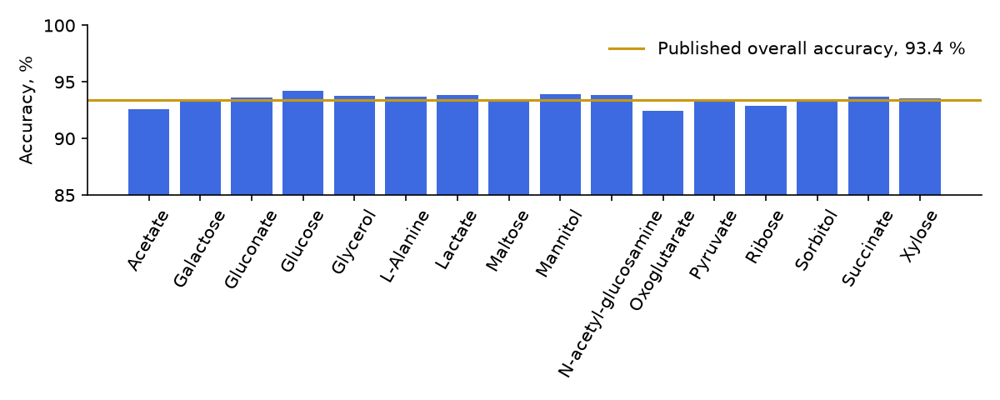
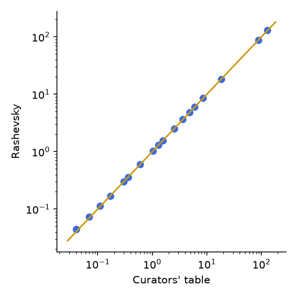
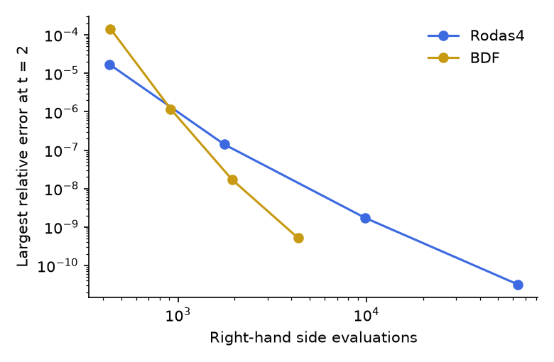

# Validation

This file is written by `validation/report.py` from `validation/results`. To reproduce every number:

```
cargo build --release -p rashevsky-cli
python -m venv .venv && . .venv/bin/activate
pip install -r validation/requirements.txt
(maturin develop --release is needed only for the notebook)
CARGO_TARGET_DIR=target python validation/run_all.py
```

Each script below also runs alone, from `validation/`, and prints what it finds. References are other tools run on this machine on the same files, or numbers from the named publication. External tools: COBRApy 0.32.1, libRoadRunner 2.11.0, COPASI 4.48.311 (Source).

| Check | Criterion | Result | Verdict |
| --- | --- | --- | --- |
| iCH360 growth | within 1e-6 of COBRApy | 0.865627 with HiGHS, 0.865627 with the dense simplex | pass |
| `e_coli_core` growth | 0.8739 1/h from BiGG; within 1e-6 of COBRApy | 0.873922 with HiGHS, 0.873922 with the dense simplex | pass |
| FVA at 100 % of optimum | within 1e-6 of COBRApy | largest difference 3.9e-12 over 95 reactions | pass |
| FVA at 90 % of optimum | within 1e-6 of COBRApy | largest difference 5.0e-13 | pass |
| iML1515 essentiality | within 0.5 points of the published 93.4 % | 93.475 % of 23,617 phenotypes, MCC 0.7582 | pass |
| Human-GEM essential tasks | all pass; same verdicts as RAVEN | 57 of 57 | pass |
| Human-GEM balance | same imbalanced set as COBRApy | 10,863 of 11,094 balanced, 223 imbalanced, 8 undetermined | pass |
| Control theorems | under 1e-8 on five models | worst scaled residual 5.8e-12 | pass |
| Teusink steady state | the curators' table; libRoadRunner within 1e-5 | all 19 values in tolerance; libRoadRunner 8.1e-15 | pass |
| Recon3D | same size, objective and 2,248 gene deletions within 1e-6 relative of COBRApy, FVA within 1e-5 | objective 755.0032, deletions 5.2e-14, FVA 3.5e-08 | pass |
| Enzyme constraints on eciML1515 | within 1e-6 of a certified optimum in 7 conditions | largest difference 1.6e-14 | pass |
| SBML semantic suite | at least 95 % of applicable cases | 1700 of 1700 with Rodas4, 1700 of 1700 with BDF | pass |

## iCH360 against COBRApy

The bundled model. `validation/v13_ich360_cobrapy.py` runs every comparison of `v01` below on it, with the same tolerances. The authors publish no growth rate to match.

| Analysis | COBRApy | Rashevsky or largest difference | Verdict |
| --- | --- | --- | --- |
| pFBA total flux | 758.025093 | 758.025093 | pass |
| Loopless objective | 0.865627 | 0.865627 | pass |
| CycleFreeFlux exchanges | | difference 3.4e-13 | pass |
| Single gene deletions (356) | | difference 1.3e-10 | pass |
| Single reaction deletions (349) | | difference 1.4e-12 | pass |
| Double gene deletions (63,190) | | difference 5.3e-10 | pass |
| MOMA distance after deleting PGI | 373.4473 (OSQP) | 373.4477 (HiGHS QP) | pass |
| Linear MOMA distance | 98.218743 | 98.218743 | pass |
| ROOM objective | 29 | 29 | pass |
| Production envelope, 20 points | | difference 7.2e-11 | pass |
| Minimal medium total uptake | 6.447592 | 6.447592 | pass |
| Minimal medium components | 4 | 4 | pass |

FVA at 100 % and 90 % of optimum over 349 reactions: largest difference 1.5e-11 and 1.7e-11.

## `e_coli_core` against COBRApy

The textbook model, fetched from BiGG Models. `validation/v01_core_cobrapy.py`

| Analysis | COBRApy | Rashevsky or largest difference | Verdict |
| --- | --- | --- | --- |
| pFBA total flux | 518.422086 | 518.422086 | pass |
| Loopless objective | 0.873922 | 0.873922 | pass |
| CycleFreeFlux exchanges | | difference 1.2e-13 | pass |
| Single gene deletions (137) | | difference 1.1e-14 | pass |
| Single reaction deletions (95) | | difference 1.4e-14 | pass |
| Double gene deletions (9,316) | | difference 8.9e-12 | pass |
| MOMA distance after deleting PGI | 220.4801 (OSQP) | 220.4805 (HiGHS QP) | pass |
| Linear MOMA distance | 70.964998 | 70.964998 | pass |
| ROOM objective | 30 | 30 | pass |
| Production envelope, 20 points | | difference 1.1e-13 | pass |
| Minimal medium total uptake | 6.787058 | 6.787058 | pass |
| Minimal medium components | 3 | 3 | pass |

The MOMA tolerance is 1e-3 because OSQP stops at a looser tolerance than the simplex-based solvers.

## iML1515 essentiality against the Keio collection

`validation/v02_iml1515_keio.py`

Reference: Monk et al. 2017, Supplementary Note 4 and Supplementary Data 11, with its growth screens of the Keio collection on 16 carbon sources. Protocol from its Supplementary Methods: oxygen uptake bounded at 20 and the carbon source at 10 mmol/gDW/h, the reactions of genes absent from BW25113 closed, and essential below 0.05 1/h.

| | TP | FN | FP | TN | Accuracy |
| --- | --- | --- | --- | --- | --- |
| Published | 19,233 | 295 | 1,245 | 2,844 | 93.4 % |
| Rashevsky | 19,233 | 295 | 1,246 | 2,843 | 93.475 % |

1 of 23,617 rows differ from the call in the supplement: b3564 on Xylose, published growth 0.000, computed 0.717.
 COBRApy gives the same value on this row from the same BiGG file (0.7171), so the difference lies between the BiGG file of 2019 and the paper's model, not in the engine. Over the two conditions compared with COBRApy on all 1,516 genes, the largest difference is 4.9e-11.



## Human-GEM

`validation/v03_human_gem.py`

Human-GEM v2.1.1: 12,748 reactions, 8,374 metabolites, 2,870 genes, read in 0.87 s. Essential tasks of Robinson et al. 2020: 57 of 57 pass, with the verdict on every task equal to that of RAVEN's Python port on the same files (4.8 s against 29.4 s with GLPK). The verification list gives 21 of 21, same verdicts.

Of 11,094 internal reactions, 10,863 (97.9 %) balance in elements and charge and 223 do not, the same set as COBRApy's `check_mass_balance`. Another 8 involve a metabolite without a formula. This engine reports those as undetermined, and COBRApy counts them as imbalanced.

## Recon3D

`validation/v11_recon3d.py`

Recon3D from BiGG Models (Brunk et al. 2018) against COBRApy with GLPK. Reactions, metabolites and genes: 10,600, 5,835 and 2,248 in both. Biomass objective 755.003216 against 755.003216, relative difference 3.0e-16. FVA at 100 % of the optimum on 300 reactions chosen by a fixed seed: largest difference 3.5e-08. All 2,248 single gene deletions, of which 40 change the objective and 1 stops it: largest relative difference 5.2e-14. After `rashevsky convert`, libSBML finds 0 errors and COBRApy reads the same objective.

## Enzyme constraints

`validation/v12_ecmodel.py`

The published `eciML1515` batch model (ecModels commit 8c50008) with its pool of 0.0909 g/gDW. The file's `_REV` and isozyme reactions were folded back into 2,712 reactions, and its enzyme coefficients read out as data for the enzyme module: 1,259 enzymes in 2,560 catalyses, 381 of them complexes and 670 of the enzymes shared between catalyses. The reference is the same program with the enzyme rows eliminated by algebra, solved by HiGHS and closed by a dual upper bound, which holds for any dual vector because every variable has finite bounds.

| Condition | Certified optimum | Upper bound | Enzyme module | Engine on the GECKO file | COBRApy on the GECKO file | Verdict |
| --- | --- | --- | --- | --- | --- | --- |
| batch, unlimited glucose | 0.57438064 | 0.57438064 | 0.57438064 (2e-14) | 0.57438064 (9e-15) | 0.57438064 (5e-09) | pass |
| glucose uptake 10 | 0.31121729 | 0.31121729 | 0.31121729 (3e-15) | 0.31121729 (3e-15) | 0.31121729 (2e-09) | pass |
| glucose uptake 5 | 0.22370489 | 0.22370489 | 0.22370489 (1e-14) | 0.22370489 (1e-14) | 0.22370489 (2e-09) | pass |
| glucose uptake 1 | 0.06425162 | 0.06425162 | 0.06425162 (1e-14) | 0.06425162 (4e-16) | 0.06425162 (4e-16) | pass |
| half the protein pool | 0.28085730 | 0.28085730 | 0.28085730 (8e-15) | 0.28085730 (3e-15) | 0.28085730 (5e-09) | pass |
| twice the protein pool | 1.16142732 | 1.16142732 | 1.16142732 (1e-14) | 1.16142732 (1e-15) | 1.16142732 (5e-10) | pass |
| no oxygen | 0.49712429 | 0.49712429 | 0.49712429 (4e-15) | 0.49712429 (3e-15) | 0.49712429 (4e-10) | pass |

Relative differences from the certified optimum are in brackets. COBRApy cannot read the file as published, because it decodes `R_protein__32__pseudoreaction` to an identifier with a space, so it reads a copy with that one encoding replaced.

This check found a defect. HiGHS removes matrix entries at or below `small_matrix_value`, 1e-9 by default. `eciML1515` has 17 enzyme costs at or below that value, the smallest 5.6e-11, and without them those enzymes are free: the same file then gave 0.49713418 without oxygen against a true 0.49712429. The engine now sets 1e-12, the lowest value HiGHS accepts.

## Kinetic models

`validation/v04_teusink_mca.py`

Reference values: Table 4 of Teusink et al. 2000 as reproduced by the BioModels curators in the notes of BIOMD0000000064, together with their curated model's column. The publisher's site refused direct access to the paper (HTTP 403), so the table was read from those notes. The curators note that the G6P of the curated model differs slightly from the paper's. Tolerance: one unit in the last printed digit of the curators' column.

| Quantity | Published | Curated model | Rashevsky | Verdict |
| --- | --- | --- | --- | --- |
| vGLK | 88 | 88 | 88.1495 | pass |
| vADH | 129 | 129 | 129.2159 | pass |
| vGLYCO | 6 | 6 | 6.0000 | pass |
| vTreha | 4.8 | 4.8 | 4.8000 | pass |
| vG3PDH | 18.2 | 18.2 | 18.2022 | pass |
| vSUC | 3.6 | 3.6 | 3.6404 | pass |
| G6P | 1.07 | 1.03 | 1.0332 | pass |
| F6P | 0.11 | 0.11 | 0.1128 | pass |
| F16P | 0.6 | 0.6 | 0.6019 | pass |
| P3G | 0.36 | 0.36 | 0.3565 | pass |
| P2G | 0.04 | 0.04 | 0.0448 | pass |
| PEP | 0.07 | 0.07 | 0.0736 | pass |
| PYR | 8.52 | 8.52 | 8.5232 | pass |
| ACE | 0.17 | 0.17 | 0.1701 | pass |
| ATP | 2.51 | 2.51 | 2.5084 | pass |
| ADP | 1.29 | 1.29 | 1.2921 | pass |
| AMP | 0.3 | 0.3 | 0.2995 | pass |
| NAD | 1.55 | 1.55 | 1.5456 | pass |
| NADH | 0.04 | 0.04 | 0.0444 | pass |

The same file in libRoadRunner gives the same steady state: largest relative difference 8.1e-15 over species and 6.5e-15 over fluxes. Scaled control coefficients match COPASI: largest difference 3.4e-07 for flux and 1.4e-06 for concentration, COPASI's being computed with finite-difference elasticities. libRoadRunner's own control matrices raise an exception on this model. The Rust test `control_coefficient_matches_a_perturbation` also checks a coefficient against a direct perturbation of the transporter's Vmax.



### Control theorems

Scaled residuals, the form in which the theorems are stated. The unscaled residuals carry the units of the elasticities and are in the results file.

| Model | Reactions | Conserved moieties | Flux summation | Concentration summation | Flux connectivity | Concentration connectivity |
| --- | --- | --- | --- | --- | --- | --- |
| BIOMD0000000061, Hynne 2001 yeast glycolysis | 24 | 5 | 4.7e-15 | 7.8e-15 | 5.2e-14 | 1.9e-12 |
| BIOMD0000000064, Teusink 2000 yeast glycolysis | 17 | 8 | 8.9e-15 | 2.6e-14 | 1.6e-13 | 1.6e-13 |
| BIOMD0000000071, Bakker2001_Glycolysis as named in the file | 14 | 4 | 1.2e-14 | 1.9e-15 | 8.8e-14 | 3.1e-14 |
| BIOMD0000000172, Pritchard and Kell 2002 yeast glycolysis | 19 | 10 | 2.3e-12 | 2.9e-12 | 2.2e-12 | 2.7e-12 |
| BIOMD0000000176, Conant and Wolfe 2007 yeast glycolysis | 19 | 10 | 1.8e-12 | 1.4e-12 | 5.8e-12 | 4.4e-12 |

## SBML Test Suite

`validation/v05_sbml_suite.py`, SBML Test Suite 3.5.0

Semantic cases: 1,823 in the suite, 1,700 applicable. The 123 left out use the `comp` package, which this engine does not implement. A case passes when every output is within the suite's own tolerance, `|sim - ref| <= absolute + relative |ref|`.

| Integrator | Passed | Percent | Seconds |
| --- | --- | --- | --- |
| Rodas4 | 1,700 of 1,700 | 100.00 | 93 |
| BDF | 1,700 of 1,700 | 100.00 | 24 |

Of these, 34 are flux balance cases and 35 use fast reactions, simulated by the singular perturbation of `docs/MODEL.md`. Random tie-breaking between events uses a fixed seed.

### Every SBML version, and files written by the engine

Rodas4 on each version a case provides. The round trips write each model as SBML Level 3 Version 1 and read that back before running it.

| Form | Passed | Failures |
| --- | --- | --- |
| l2v1 | 1,051 of 1,051 | none |
| l2v2 | 1,234 of 1,234 | none |
| l2v3 | 1,234 of 1,234 | none |
| l2v4 | 1,251 of 1,251 | none |
| l2v5 | 1,250 of 1,251 | 01399 |
| l2v5, written and read back | 1,250 of 1,251 | 01399 |
| l3v1 | 1,490 of 1,490 | none |
| l3v1, written and read back | 1,490 of 1,490 | none |
| l3v2 | 1,569 of 1,569 | none |
| Newest version, written and read back | 1,700 of 1,700 | none |

Case 01399 at Level 2 Version 5: the suite's file for that version omits `fast="true"`, which the other versions of the case have, so its expected output does not follow from it.

### Stochastic cases

The 39 `StochasticTimeCourse` cases of the DSMTS (Evans, Gillespie and Wilkinson 2008), with 40,000 realizations each. The suite accepts a mean `Z` in (-3, 3) and a variance `Y` in (-5, 5) at each time point, and states that a correct simulator can fail a few points. The limit used here is 3 per case, with a flagged case repeated once on an independent seed, because the points of a case are strongly correlated and one excursion can flag many of them.

- Flagged on the first seed: none.
- Still over the limit on the second seed: none.

**Case 00003 is decided by its exact law, not by this criterion.** It is a birth-death process (Kendall 1948) whose kurtosis reaches 96, while `Y` assumes the sampling error of a normal population and so overstates significance by a factor of `sqrt((kurtosis - 1) / 2)`. Whether its `Y` stays under the limit therefore depends on the random stream: this run flags 2 of its points, and earlier runs with other streams went over the limit on both seeds. Compared with the exact variance using its exact sampling error at 2,000,000 realizations, the largest `|z|` is 3.30 for the variance and 2.30 for the mean, with a limit of 4.

The other cases of the stochastic folder test the `distrib` package, which this engine does not implement.

## Flux sampling

`validation/v06_sampling.py`

`e_coli_core` with biomass at 90 % of its optimum or more, a polytope of dimension 24. Criterion: means within 0.15 of a flux standard deviation.

| Comparison | Largest difference of means, in flux SD | Reaction |
| --- | --- | --- |
| CHRR against COBRApy OptGP | 0.081 | NADH16 |
| OptGP against COBRApy OptGP | 0.074 | NADTRHD |
| CHRR against OptGP | 0.048 | ACALD |

iCH360, the same way, a polytope of dimension 45, 309 reactions compared: CHRR against COBRApy 0.098, OptGP against COBRApy 0.095, CHRR against OptGP 0.043. COBRApy's OptGP is run here with all its warmup points: by default it discards those it finds redundant, and on iCH360 that holds `ASNS1` at 0 in all 1,500 samples, against a mean of 0.091 with CHRR, narrows `ASNS2` to a standard deviation of 0.0007 against 0.054 with CHRR, and moves its mean by 1.7 of CHRR's standard deviations. `e_coli_core` runs stock COBRApy.

Diagnostics on `e_coli_core`: CHRR split R-hat 1.002, smallest effective sample size 1410, largest Geweke z 3.8, in 0.43 s. OptGP R-hat 1.001, effective size 2852, Geweke z 3.4, in 1.49 s. On iCH360: CHRR R-hat 1.001, effective size 3985, Geweke z 3.0, in 5.3 s. OptGP R-hat 1.001, effective size 4637, Geweke z 3.1, in 94 s. A Rust test checks uniformity on a simplex against its exact mean and variance, and convergence on iCH360 for several seeds.

## Outputs

`validation/v07_overlay_escher.py`

pFBA on Human-GEM projected onto the human-metabolism-r97-expanded-20261025 scene: 376 of 2,039 events reached by a Reactome or Rhea identifier, 809 more by an EC number only, 268 carrying flux. Event totals match a separate recomputation from the SBML text to 0.0e+00, and every event identifier exists in the scene. The Escher map validates against Escher's published 1-0-0 schema: yes.

### SBML written by the engine

`validation/v09_sbml_export.py`

| Model | Errors from libSBML | Reactions | Objective read by COBRApy, original | Rewritten | Verdict |
| --- | --- | --- | --- | --- | --- |
| iCH360 | 0 | 349 | 0.865627 | 0.865627 | pass |
| e_coli_core | 0 | 95 | 0.873922 | 0.873922 | pass |
| iML1515 | 0 | 2,712 | 0.876997 | 0.876997 | pass |
| Human-GEM | 0 | 12,748 | 138.532699 | 138.532699 | pass |

The rewritten Teusink model reaches the same steady state in libRoadRunner, largest relative difference 0.0e+00.

## Numerical studies

`validation/v08_numerics.py`

### Integrators

Relative error at t = 2 on the Teusink model, against a run at `rtol = 1e-12`. Rust tests also check Rodas4's order of 4 at fixed step, the stiff Prothero-Robinson problem with an exact solution, Robertson's problem with its conservation law, and an index-1 algebraic equation, for both methods.

| Method | `rtol` | Largest relative error | Steps | Right-hand side evaluations |
| --- | --- | --- | --- | --- |
| BDF | 0.0001 | 1.4e-04 | 174 | 438 |
| BDF | 1e-06 | 1.2e-06 | 352 | 916 |
| BDF | 1e-08 | 1.7e-08 | 685 | 1937 |
| BDF | 1e-10 | 5.2e-10 | 1410 | 4347 |
| Rodas4 | 0.0001 | 1.7e-05 | 67 | 433 |
| Rodas4 | 1e-06 | 1.4e-07 | 290 | 1761 |
| Rodas4 | 1e-08 | 1.7e-09 | 1636 | 9837 |
| Rodas4 | 1e-10 | 3.2e-11 | 10576 | 63487 |



### Dynamic FBA

`e_coli_core` on glucose through depletion. Observed order of convergence of the final biomass: 0.94 and 1.14, for a scheme that is first-order once fluxes change. A Rust test checks the exponential phase against its closed form.

### Thermodynamics

TFA on iCH360 with 186 eQuilibrator energies: growth 0.865627 against 0.865627 without them, 0 fluxes against their Gibbs energy, and every reported `DrG'` within two standard uncertainties of its value recomputed from the reported concentrations (largest excess 9.8e-14 kJ/mol). The sign logic also has Rust tests on small networks with known answers.

### Review

A fresh-context review read the numerics cold against the papers and against independent implementations. Three rounds reported 39, 28 and 10 groups of defects, each with a failing input, and each is now a regression test: `crates/rashevsky/tests/kinetic_edges.rs`, `constraint_edges.rs` and `overlay.rs`, with the models in `crates/rashevsky/tests/models`. On the same system, a birth-death species of true mean 1 beside a large population reads 1.45 with this engine's tau-leaping and 1.81 with GillesPy2's, so that bias belongs to the explicit method (`docs/MODEL.md`).

### Sensitivity and estimation

Rust tests, with Python and command-line tests of the same calls. Local sensitivities equal the analytic derivatives of a birth-death model and central finite differences on the Teusink model. Sobol indices match the closed form of a product of independent inputs at 2,000,000 samples, and the Ishigami function. On a fixed sample the model route gives the same indices as the closed-form output, from solved steady states and from a late time point. A fit recovers known rates from noise-free data, its profile brackets them, and a non-identifiable pair gives an open profile.

## Performance

`validation/v10_performance.py`

12th Gen Intel(R) Core(TM) i5-12400, 12 logical cores, sharing the machine with other work, so these are indicative. COBRApy used GLPK with 4 processes.

| Task | Rashevsky | COBRApy |
| --- | --- | --- |
| Read iCH360 | 0.03 s | 0.41 s |
| Read e_coli_core | 0.01 s | 0.11 s |
| Read iML1515 | 0.15 s | 2.31 s |
| Read Human-GEM | 0.57 s | 9.65 s |
| FVA of iML1515, 2,712 reactions | 2.1 s | 5.8 s |
| All single gene deletions of iML1515 | 2.9 s | 3.0 s |

FVA of iML1515 agrees with COBRApy to 1.8e-06. Essential tasks of Human-GEM take 4.0 s, a 100-minute time course of the Teusink model at 1,000 points 0.14 s, and 10,000 CHRR samples of `e_coli_core` 0.44 s, each including reading the file.

